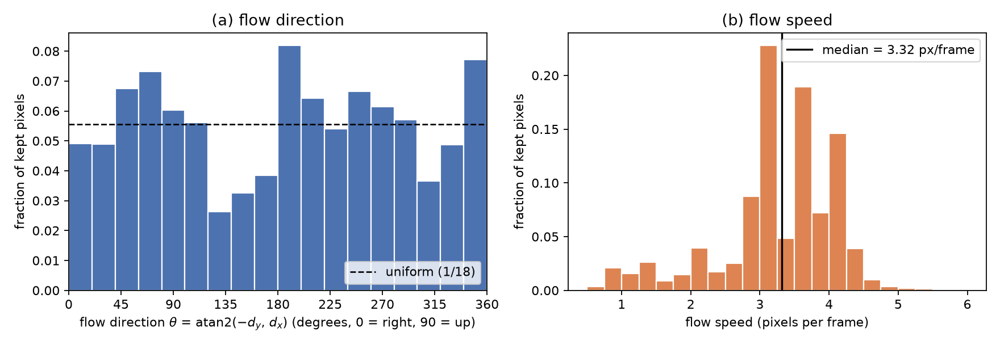

# Question 2: Motion or Memory?

All code, checkpoints, logs and GIFs are in the repository linked on page 1. Every number below comes from the scripts named in brackets. Learned-model entries are **mean (seed 0, seed 1)**. Figures and per-video histograms use the seed-0 model unless stated. Errors are given to three significant figures, with scientific notation below $10^{-3}$. **Hardware:** {{HARDWARE}}.

## 1. Setup

**Data.** `torchvision.datasets.MovingMNIST(root="data", split=None, download=True)` gives all 10,000 videos (20 x 1 x 64 x 64, uint8). Videos are split by index: 0-7,999 train, 8,000-8,999 validation, 9,000-9,999 test, and divided by 255 into [0, 1] (`pa2/data.py`). Mirror is `torch.flip(x, dims=(-1,))`, rotation is `torch.rot90(x, k=1, dims=(-2, -1))`, and a group element $MR^a$ applies $R^a$ first and then $M$. The window function returns the five input frames, the existing target frames (zero-filled beyond frame 20) and a validity mask, and it is the same function used in training and evaluation.

**Table 1.** Transformation and frame-window checks (`scripts/table1_checks.py`). All rows match.

{{table1}}

**Figure 1.** Farneback optical flow on the first 50 training videos (950 consecutive frame pairs), keeping pixels brighter than 0.2 in both frames with flow magnitude above 0.5 px (`scripts/fig1_flow.py`).

<b>Figure 1.</b> (a) Direction histogram, fraction of kept pixels in 18 bins of 20°, dashed line at 1/18. (b) Speed histogram, fraction of kept pixels, with the median marked. Median speed {{FIG1_MEDIAN}} px/frame, {{FIG1_NPIX}} pixels kept from 950 frame pairs.

### Q2.1

**Direction.** Every 20° bin is populated: the smallest holds {{FIG1_DIRMIN}} of the kept pixels and the largest {{FIG1_DIRMAX}}, against 0.0556 for a uniform distribution. The histogram is uneven (about a 3x spread between bins), but no direction is missing or rare. Mirroring every video would map each direction $\theta$ to $180° - \theta$, and a 90° rotation would map $\theta$ to $\theta + 90°$. Both only move mass between bins that are all well populated. The L1 distance between the histogram and its mirrored version is {{FIG1_MIRL1}}, and {{FIG1_ROTL1}} for its rotated version, the same order as its distance to a uniform histogram ({{FIG1_UNIL1}}). With only 100 digits in 50 videos, each contributing a few straight segments, this level of unevenness is expected from sampling. So mirrored and rotated **trajectories** should already be familiar to a model trained on this data. Only the mirrored or rotated digit **shapes** are new.

**Speed.** A typical digit moves {{FIG1_MEDIAN}} px per frame (median). 80% of kept pixels lie between {{FIG1_P10}} and {{FIG1_P90}} px/frame and 99% are below {{FIG1_P99}}. At 2× a typical digit therefore moves about {{FIG1_2X}} px between the frames the model sees, and at 3× about {{FIG1_3X}} px. Both are far outside the training range: only {{FIG1_ABOVE6}}% of kept training pixels move faster than 6 px/frame (the x-axis of Figure 1(b) stops at 6 px).

**Overlap bias.** Where digits overlap, Farneback sees one merged blob whose shape changes, so flow there is unreliable. I checked how much this matters by splitting the frame pairs with a connected-component test (`n_blobs` in `pa2/data.py`): {{FIG1_OVL}}% of kept pixels come from pairs where the two digits touch or overlap in at least one frame. Their median speed is {{FIG1_OVL_MED}} px/frame against {{FIG1_SEP_MED}} for pairs with separate digits, so overlap pulls speeds down only slightly. They also make up {{FIG1_OVL_LOW}}% of the slowest 10% of pixels, about their overall share, so they do not dominate the slow tail. Using only the pairs with separate digits, the direction histogram still covers every bin ({{FIG1_SEP_DIRMIN}} to {{FIG1_SEP_DIRMAX}}, L1 distance {{FIG1_SEP_L1}} from the full histogram). The bias is too small to change either answer: all directions are familiar, and 2× and 3× are not.

### Q2.2

| Transformation | Motion statistics | Digit appearance |
|---|---|---|
| Mirror $M$ | Unchanged in distribution. Directions map $\theta \to 180° - \theta$, speeds are kept, and bounces stay valid in the symmetric box. Since training directions already cover the circle (Q2.1), mirrored motion is in-distribution, although a finite training set is never exactly symmetric. | Changed: a mirrored 2, 3, 4, 5, 7 or 9 is not a digit shape the model has seen. |
| Rotation $R$ | Unchanged in distribution, for the same reason ($\theta \to \theta + 90°$, speeds kept). | Changed even more: strokes that are vertical become horizontal, and all ten digit shapes are new. |
| Speed-up 2×, 3× | Changed: displacements per seen frame double or triple, outside the training range. | Unchanged: every frame is an ordinary training-style frame. |

This makes the three tests a controlled experiment. Mirror and rotation hold the motion distribution fixed and change only appearance, so a failure there points to a motion rule tied to how digits look. Speed-up holds appearance fixed and changes only the motion, so a failure there points to unfamiliar motion or to limited reach. Each test changes one factor, so the cause of a failure can be read off.

## 2. Baseline: ConvLSTM

**Model A** (`pa2/models.py`, config `A`): `pixel_unshuffle(x, 4)` to 16 x 16 x 16, two ConvLSTM layers (64 hidden channels, 3 x 3, stride 1, padding 1, one convolution producing $[i, f, o, g]$, no peepholes, zero initial states), a 1 x 1 convolution 64 to 16, `pixel_shuffle(., 4)` and a sigmoid. PyTorch default initialisation and `bias=True` everywhere. **Trainable parameters: 480,784** (layer 1: $(16+64) \cdot 256 \cdot 9 + 256 = 184{,}576$, layer 2: $128 \cdot 256 \cdot 9 + 256 = 295{,}168$, output: $64 \cdot 16 + 16 = 1{,}040$). The forward pass runs 9 steps: steps 1-5 read the input frames, steps 6-9 read the model's own previous prediction (no teacher forcing, gradients flow through the fed-back frames), and the outputs of steps 5-9 form $\hat Y$.

**Training** (`pa2/train.py`): Adam, learning rate $10^{-3}$, no schedule, batch 32, 30 epochs, final-epoch weights kept. Each epoch shuffles the 8,000 training videos and draws one window per video (models A, B: $t \in \{1, \dots, 11\}$ at 1×). The loss is the squared error averaged over pixels and valid target frames of each video, then over the videos in the batch. Seeds 0 and 1 control initialisation, shuffling, window and augmentation sampling. Validation (1×, $t = 1$) is logged every epoch for monitoring only.

**Table 2.** Test errors at 1×, $t = 1$ (`scripts/phase1_baseline.py`).

{{table2}}

{{FIG2_PANELS}}

<b>Figure 2.</b> Model A (seed 0) on three test videos at 1×, $t = 1$: input frames 1-5, predictions for frames 6-10, and ground truth frames 6-10. {{FIG2_CAPTION}}

### Q2.3

**Reach of model A: 8 px per time step.**

1. *Patch folding.* `pixel_unshuffle(x, 4)` turns each 4 x 4 pixel patch into one cell of a 16 x 16 grid. Moving one cell means moving 4 original pixels (centre to centre). Folding itself moves nothing (convention).
2. *One 3 x 3 convolution* (stride 1, dilation 1) mixes a cell with its 8 neighbours, so information moves at most **1 cell** per convolution.
3. *Layer 1* at step $\tau$ applies one 3 x 3 convolution to $[u_\tau, h^{(1)}_{\tau-1}]$. The gates are pointwise, and the cell update $c_\tau = \sigma(f) \odot c_{\tau-1} + \sigma(i) \odot \tanh(g)$ and $h_\tau = \sigma(o) \odot \tanh(c_\tau)$ are elementwise, so $h^{(1)}_\tau$ can depend on inputs at most 1 cell away.
4. *Layer 2* applies one 3 x 3 convolution to $[h^{(1)}_\tau, h^{(2)}_{\tau-1}]$. Another cell.
5. *Output.* The 1 x 1 convolution, `pixel_shuffle` and sigmoid do not move information.
6. *All paths within one step to $\hat x_{\tau+1}$:* from $u_\tau$: layer-1 conv then layer-2 conv = 2 cells. From $h^{(1)}_{\tau-1}$: the same two convolutions = 2 cells. From $h^{(2)}_{\tau-1}$: only the layer-2 conv = 1 cell. The recurrence does not add more within a step, because each state is used once per step. The longest path is **2 cells = 2 x 4 = 8 original pixels**.

An autograd check (`scripts/reach_check.py`) confirms it: the gradient of one output cell with respect to $u_\tau$ and $h^{(1)}_{\tau-1}$ is non-zero only within 2 cells, and with respect to $h^{(2)}_{\tau-1}$ within 1 cell. Over several steps reach adds up (8 px per step), but a digit's new position must connect to its old position, held in the state, within one update. With Figure 1's median of {{FIG1_MEDIAN}} px/frame, 1× motion is well inside 8 px, 2× ({{FIG1_2X}} px) is near the limit, and 3× ({{FIG1_3X}} px) exceeds it.

