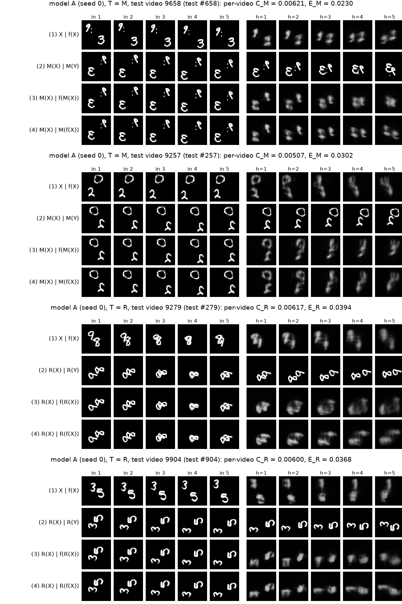
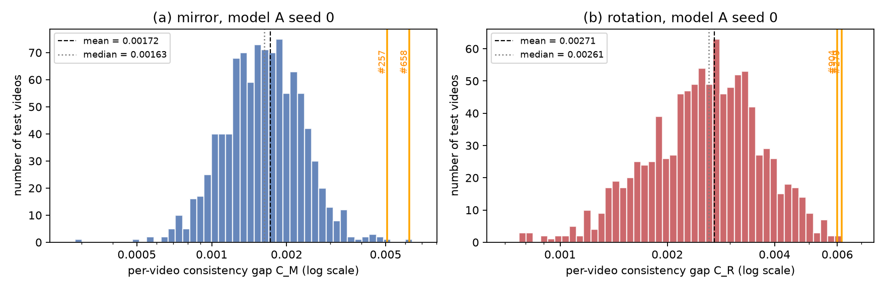
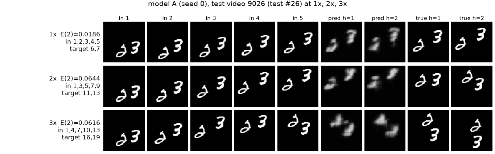

### Q2.4

{{ANSWER_Q2_4}}

### Q2.5 (prediction, written and committed before any test in Section 3)

{{ANSWER_Q2_5_COMMITTED}}

Inserted by the report build directly from the git commit recorded in <code>logs/phase2_gate.txt</code> (<code>answers/Q2_5.md</code>), committed at {{Q2_5_COMMIT}}. The stress tests started at {{PHASE2_START}} (<code>logs/phase2_gate.txt</code>).

## 3. Testing the Baseline

### Mirror and rotation

**Table 3.** Error at 1×, consistency gaps and transformed errors, $t = 1$ (`scripts/phase2_stress.py`).

{{table3}}

<b>Figure 3.</b> The two test videos with the largest per-video CM and the two with the largest CR (model A, seed 0). Rows: (1) X | f(X), (2) T(X) | T(Y), (3) T(X) | f(T(X)), (4) T(X) | T(f(X)). GIFs stepping through the five horizons: {{FIG3_GIFS}}.

<b>Figure 4.</b> Per-video CM (a) and CR (b) of model A (seed 0) over the 1,000 test videos, log scale. Orange lines mark the Figure 3 videos.

### Q2.6

{{ANSWER_Q2_6}}

### Q2.7

{{ANSWER_Q2_7}}

### Q2.8

{{ANSWER_Q2_8}}

### Faster motion

**Table 4.** Model A and Copy-last across speeds, $t = 1$. Only valid targets are scored, so the 3× column uses the two existing targets (frames 16 and 19).

{{table4}}

<b>Figure 5.</b> Model A (seed 0) on one test video whose digits do not overlap in any displayed true frame: five input frames, the first two predictions and the first two true frames at 1×, 2× and 3×. {{FIG5_CAPTION}}

### Q2.9

{{ANSWER_Q2_9}}

### Q2.10

{{ANSWER_Q2_10}}

