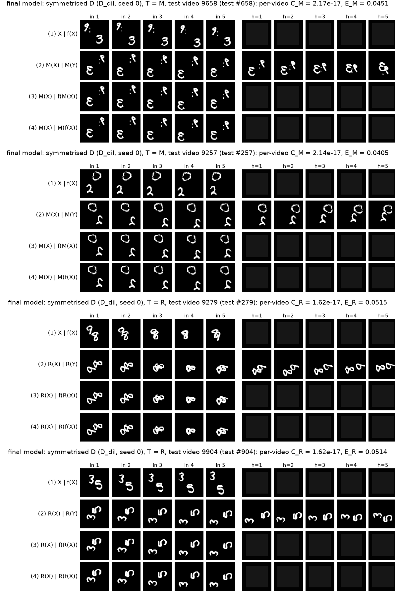
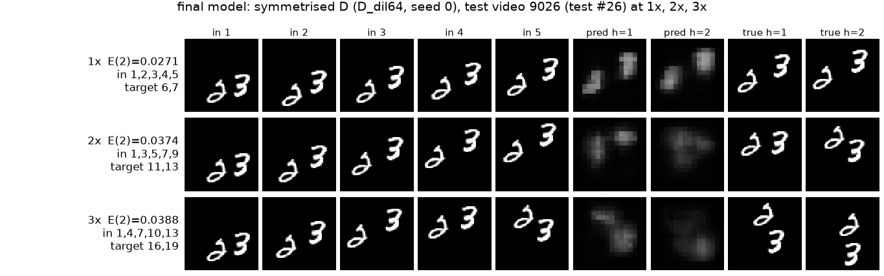

## 4. What Can Data Fix?

### Q2.11 (prediction, written and committed before training B, C and D)

{{ANSWER_Q2_11_COMMITTED}}

Inserted by the report build directly from the git commit recorded in <code>logs/phase3_gate.txt</code> (<code>answers/Q2_11.md</code>), committed at {{Q2_11_COMMIT}}. Training of B, C and the D candidates started at {{PHASE3_START}} (<code>logs/phase3_gate.txt</code>).

**Model D selection (validation split only).** Each candidate was trained exactly like a final model (30 epochs, seeds 0 and 1). The rule, fixed before any candidate was trained, is the lowest validation E(2) averaged over 1×, 2×, 3× and both seeds. The chosen candidate's two runs are model D. Entries are mean (seed 0, seed 1).

{{d_selection}}

**Table 5.** Models A to D on the test split. Training time is the mean wall-clock time per epoch over the 30 epochs. Inference time is the time to predict the 1,000 original test videos (1×, $t = 1$) at batch 32 under `eval()` and `no_grad()`, timed after the batches are on the device, as the median of three passes after one warm-up pass.

{{table5}}

### Q2.12

{{ANSWER_Q2_12}}

### Q2.13

{{ANSWER_Q2_13}}

### Q2.14

{{ANSWER_Q2_14}}

## 5. The Final Model

**Why the symmetrised forecaster has $C_M = C_R = 0$.** Every $g \in G$ only permutes pixels, so it is linear and commutes with averaging. For any $T \in G$,
$$\bar f(T X) = \frac{1}{8} \sum_{g \in G} g^{-1} f(g T X) = \frac{1}{8} \sum_{g' \in G} T g'^{-1} f(g' X) = T \bar f(X),$$
substituting $g' = gT$ (so $g^{-1} = T g'^{-1}$), which runs over all of $G$ as $g$ does. Hence $\bar f(T X) = T \bar f(X)$ for every $X$, and $C_T = \mathrm{MSE}(\bar f(TX), T \bar f(X)) = 0$ for $T = M$ and $T = R$, whatever $f$ is. In floating point the eight terms are summed in a different order on each side, so the measured gaps are at rounding level.

{{FINAL_CHOICE}}

**Table 6.** Symmetrised models, same columns as Table 5. Training time is that of the underlying learned model. Inference time includes all eight transformations, forward passes, inverse transformations and the averaging.

{{table6}}

<b>Figure 6(a).</b> Figure 3 repeated with the final model on exactly the same videos. GIFs: {{FIG6_GIFS}}.

<b>Figure 6(b).</b> Figure 5 repeated with the final model on exactly the same video.

### Q2.15

{{ANSWER_Q2_15}}

### Q2.16

{{ANSWER_Q2_16}}

### Q2.17 (final verdict, at most 150 words)

{{ANSWER_Q2_17}}

