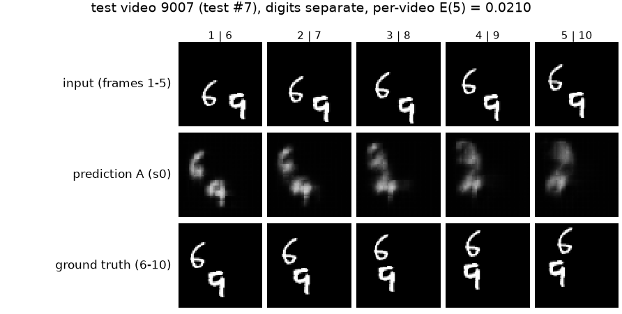
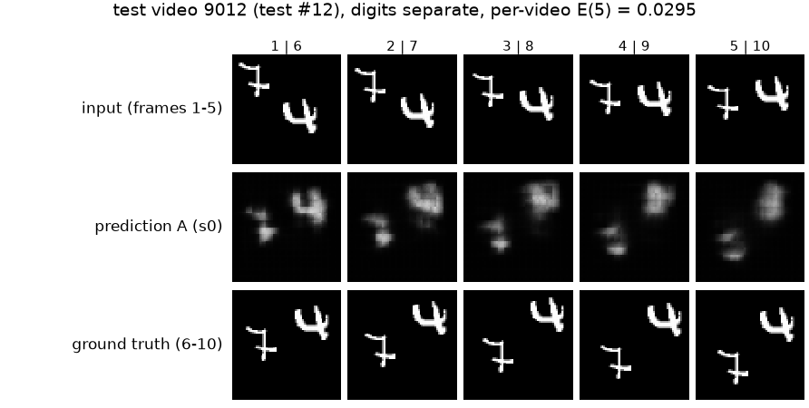
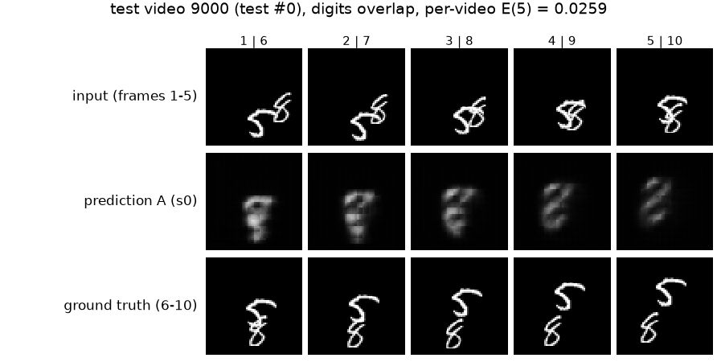
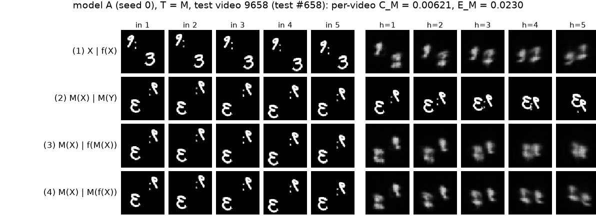
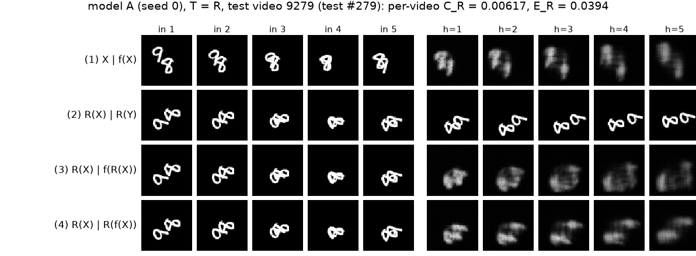
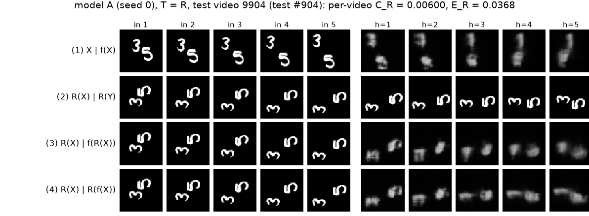
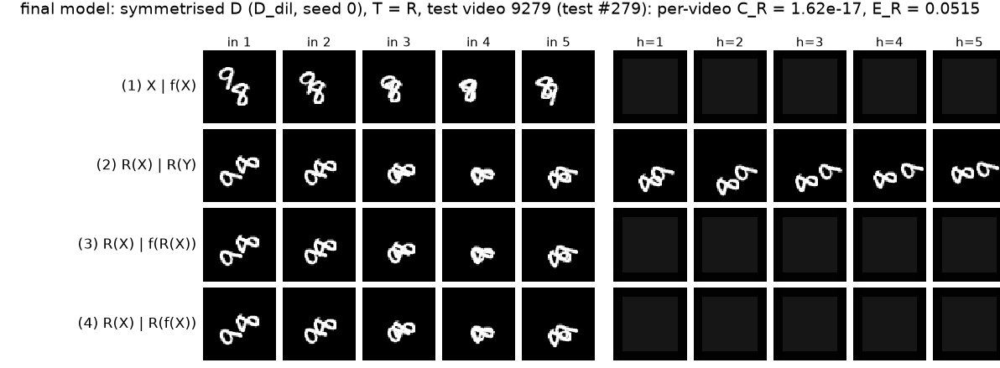
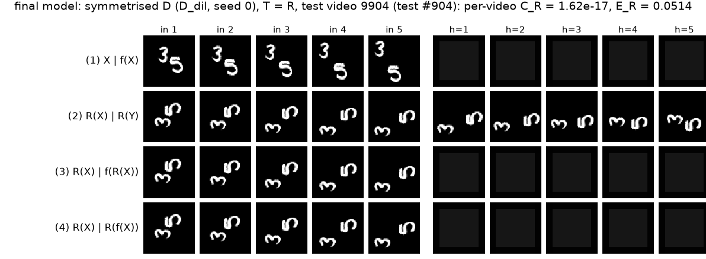

<h1 class="title">AI651 Deep Learning for Space, Time and Graphs Assignment 2</h1>

**Ahmed Jawed** (Roll no. 25280040)
LUMS, Fall 2026

**GitHub repository:** [https://github.com/ahmedjawedaj/dl4stg-pa2](https://github.com/ahmedjawedaj/dl4stg-pa2)

Question 1: River forecasting proposal. Question 2: Motion or memory? (ConvLSTM on Moving MNIST).

# Question 1: River Forecasting Proposal

## 1. Architecture diagram

{width=100%}

{width=70%}

**Proposed system.** A river-graph space-time network. Every ten minutes it reads everything known at issuance time $t_0$ (24 h of levels at S1-S4 and T1, rainfall at R1 and R2, recorded releases, and the release schedule announced up to $t_0$), places these on a small directed graph that follows the river, and predicts the level at S1-S4 at $t_0 + 60$ min with a median and an 80% band. Temporal blocks (T) learn how each location responds over time. Spatial blocks (S) pass information downstream along the river, one hop per block. Four T-S pairs give the reach needed for the reservoir signal to arrive at S4 and for travel times of several hours to fit inside the model's view.

**Combining sources.** All sources are resampled onto one 10-minute grid (rainfall summed over each interval, levels taken at the interval end, schedules held as step functions). Each source becomes channels of the node it describes: levels on S1-S4 and T1, releases and schedule on the reservoir node Res, and rainfall on every node. Channels that do not apply to a node are zero with a zero mask. A projection per node type ($W_\text{type}: \mathbb{R}^{14} \to \mathbb{R}^{64}$) maps these heterogeneous inputs to a common width, so a level sensor, the reservoir and the latent tributary node can share the same T and S blocks afterwards. The time axis is extended by six future positions ($t_0+10$ to $t_0+60$ min). There, only the announced release schedule is filled in. Every measured channel is masked, so future rainfall and future levels never enter the model.

## 2. Assumptions

**Supplied facts (not assumptions).** Levels at S1-S4 and T1 every 10 minutes. Rainfall at R1 and R2 with timestamps and locations. Recorded releases and announced schedules with announcement and effective times. Station locations, river connectivity and distances. The monitored tributary joins between S1 and S2 and the unmonitored one between S2 and S3. Travel times are not supplied and change with conditions. Future rainfall and levels are unavailable at issuance.

| ID | Assumption | Why reasonable | Effect on design |
|---|---|---|---|
| A1 | All timestamps can be converted to one clock (UTC). A level stamp refers to the end of its 10-minute interval. | Telemetry systems normally log in UTC or a fixed local offset. | One shared grid. Rainfall is summed over $(t-10, t]$ so it never includes later rain. |
| A2 | At least 3 years of 10-minute history exist and include several high-flow events. | Typical for an authority that runs a reservoir and flood stations. | Enough data to learn travel times and rainfall response. With less, I would pretrain on synthetic events from a simple routing model (Section 6). |
| A3 | Each record has an arrival time, or the typical reporting delay is known. Most data arrive within 20 minutes, with occasional outages of hours. | Common for radio or cellular telemetry. | Training samples are built "as of" $t_0$ and delays are simulated. Age channels tell the model how stale each value is. |
| A4 | Level sensors are accurate to a few cm but have spikes, flatlines and gaps. Rain gauges under-catch in strong wind. | Usual pressure and radar level sensors and tipping-bucket gauges. | A rule-based QC step turns bad values into missing values. The model is trained with missing inputs. |
| A5 | Water travels mainly downstream. Backwater (a downstream level raising an upstream one) matters only near confluences. | Downstream dominance follows the supplied flow directions. Restricting backwater to confluences is a modelling assumption to check against observed events. | Graph edges point downstream. A weak reverse edge is kept only across the two confluences. |
| A6 | Travel time from the reservoir to S4 is at most about 8 h, and rainfall reaches the river within about 12 h. | These are provisional routing bounds, not distances or slopes inferred from the schematic. Check them using release-wave timing and rainfall-level lags in the historical record. | Start with a 24-hour history window (144 steps). Extend the window and temporal reach if historical responses exceed these bounds. |
| A7 | Travel time between stations falls as flow rises (faster waves at higher stage). | Standard open-channel behaviour. | Lags are learned and gated by the current flow state instead of being fixed. |
| A8 | Releases change in steps, are announced before they take effect, and the recorded release is close to the schedule except during operational changes or emergencies. | How release schedules are usually published. | The schedule is a step-function channel. The past difference between actual and scheduled release is an input (Section 5). |
| A9 | Rain at R2 is the best available proxy for the unmonitored tributary catchment, and R1 for the S1 and T1 area. | Gauge positions in the handout figure. | The latent node U gets rainfall but is never trained against a measured value. Both gauges still reach every node. |
| A10 | Channel geometry, station datums and operating rules stay roughly constant over the training period. | Major changes are rare and logged. | One model for all seasons. Retraining after logged changes or detected drift. |
| A11 | Each station's level is in its own local datum. | Usual practice. | Levels are normalised per station and the model predicts the change from the last valid level. |

## 3. Forecasting task and data specification

* **Forecast origin** $t_0$: the nominal 10-minute mark (hh:00, hh:10, ...) that the forecast is labelled with. Three times are kept separate: the origin $t_0$ (only data stamped $\le t_0$ is used), the data snapshot at $t_0 + 2$ min (only data that has arrived by then is used), and publication by $t_0 + 3$ min. "Issuance at $t_0$" in this proposal means this sequence.
* **History window**: 144 steps, $t_0 - 1430$ min to $t_0$ (24 h).
* **Horizon**: one hour. The service output is the level at $t_0 + 60$ min. The model also predicts $t_0+10, \dots, t_0+50$ for training and display.
* **Outputs**: for S1, S2, S3 and S4, the median and the 10% and 90% quantiles of the level at $t_0 + 60$ min.

| Tensor | Dimensions | Axis meanings | Timestamps / coverage |
|---|---|---|---|
| Levels $L$ (+ mask, + age) | B x 144 x 5 | issuance sample, history step, station (S1, S2, S3, S4, T1) | $t_0 - 1430$ ... $t_0$ min, value at step end |
| Rainfall $P$ (+ mask) | B x 144 x 2 | sample, history step, gauge (R1, R2) | accumulation over $(t - 10, t]$ |
| Recorded release $Q^\text{act}$ (+ mask) | B x 144 x 1 | sample, history step, reservoir | $t_0 - 1430$ ... $t_0$ |
| Announced schedule $Q^\text{sch}$ (+ announcement age) | B x 150 x 1 | sample, history + future step, reservoir | $t_0 - 1430$ ... $t_0 + 60$. Only announcements made at or before $t_0$ |
| Calendar | B x 150 x 2 | sample, step, (sin, cos) of time of day | $t_0 - 1430$ ... $t_0 + 60$ (always known) |
| Graph $A$, edge features $E$ | 7 x 7, 8 edges x 2 (6 downstream + 2 weak reverse at the confluences) | node, node / edge, (distance along river, direction) | static |
| Assembled input $X$ | B x 150 x 7 x 14 | sample, step, node (Res, S1, T1, S2, U, S3, S4), channel | history plus the six future steps (measured channels masked there) |
| Output $\hat Y$ | B x 4 x 3 | sample, station (S1-S4), quantile (0.1, 0.5, 0.9) | $t_0 + 60$ min |
| Training output $\hat Y^\text{all}$, target $Y$ | B x 6 x 4 x 3, B x 6 x 4 | sample, horizon, station, (quantile) | $t_0 + 10$ ... $t_0 + 60$ min |

The 14 channels per node and step are: level value, level mask, level age, R1, R2, R1 mask, R2 mask, recorded release, release mask, scheduled release, schedule age, future flag, and time of day (sin, cos).

**Alignment.** *Across time:* every source is placed on the same 10-minute grid ending at $t_0$ (A1). Rain gauges with irregular stamps are summed into the grid intervals. A value that is missing or has not arrived is set to the last valid value with mask 0. Level age is recorded explicitly in minutes. For rainfall and actual release, the sequence of masks identifies gaps within the window, without an additional age channel. If there is no previous valid value, use zero with mask 0. *Across locations:* stations are not interpolated onto a regular spatial grid. Each location is a graph node and distance enters as an edge feature, so the uneven spacing is kept. *Available at issuance:* everything in the history columns that arrived by the cut-off, the full release schedule as announced up to $t_0$, the calendar and the static graph. Not available: rainfall and levels after $t_0$, schedule changes announced after $t_0$, and the actual releases after $t_0$.

## 4. Model computations and design justification

**Notation.** $\tau \in \{t_0 - 143\Delta, \dots, t_0 + 6\Delta\}$ indexes the 150 steps ($\Delta$ = 10 min). $i \in V$ indexes nodes. $x_i(\tau) \in \mathbb{R}^{14}$ is the input. $z_i^{(\ell)}(\tau) \in \mathbb{R}^{64}$ is the representation after block $\ell$. $\mathcal{U}(i)$ is the set of nodes directly upstream of $i$ (edges $j \to i$ follow the flow) and $e_{ji}$ the edge features.

**Input projection.** $z_i^{(0)}(\tau) = W_{\text{type}(i)}\, x_i(\tau) + b_{\text{type}(i)} + \epsilon_i$, where $\epsilon_i$ is a learned node embedding.

**T block** (causal temporal convolution at each node, two layers with dilations $d_1, d_2$):
$$u_i(\tau) = z_i(\tau) + \mathrm{GELU}\Big(\mathrm{LN}\Big(\textstyle\sum_{k=0}^{2} W_{k}\, z_i(\tau - k d)\Big)\Big).$$
It only looks backwards in time, so a representation at $\tau$ never uses inputs after $\tau$. The four T blocks use dilations (1, 2), (4, 8), (16, 32), (64, 1), giving a temporal reach of $2 \times 128 + 1 = 257$ steps, more than the 150-step window.

**S block** (directed, edge-conditioned river convolution with lags):
$$z_i^{+}(\tau) = u_i(\tau) + \mathrm{GELU}\Big(\mathrm{LN}\Big(W_s u_i(\tau) + \sum_{j \in \mathcal{U}(i)} g_{ji}(\tau) \sum_{\delta=0}^{5} U_\delta\, u_j(\tau - \delta)\Big)\Big),$$
$$g_{ji}(\tau) = \sigma\big(a^\top [u_j(\tau),\, u_i(\tau),\, e_{ji}]\big).$$

The six lag taps ($\delta$ = 0 to 50 min) let a node read its upstream neighbour's recent past, and the gate $g_{ji}$ (a sigmoid per edge, not a softmax over all positions, so this is not attention) scales the message by the current flow state. Across the confluence edges (T1 to S2 and U to S3) a second, separate weight set carries a weak reverse message for backwater (A5).

**Reach.** Each S block moves information one hop. The longest path the forecast needs is Res to S1 to S2 to S3 to S4, four hops, so four S blocks are the minimum and are used. Temporal reach is the T-block reach plus up to $4 \times 5$ lag steps from the S blocks, so any input in the window at a node upstream of a station (or at the station itself) can affect that station's forecast. Information does not travel upstream, except across the two weak confluence edges, which matches the physics (A5).

**Forecast mapping.** For station $s \in$ {S1, ..., S4} and horizon $k \in \{1, \dots, 6\}$, with $\ell_s(t_0)$ the last valid level and $\sigma_s$ the station's training standard deviation of 1-hour changes:
$$[m, u, v] = \mathrm{MLP}_s\big(z_s^{(4)}(t_0 + k\Delta)\big), \qquad \hat q_{0.5} = \ell_s(t_0) + \sigma_s m,$$
$$\hat q_{0.9} = \hat q_{0.5} + \sigma_s\,\mathrm{softplus}(u), \qquad \hat q_{0.1} = \hat q_{0.5} - \sigma_s\,\mathrm{softplus}(v).$$
Predicting the change from the last level makes "no change" the default and keeps the quantiles ordered.

**Training objective.** Pinball loss over valid targets, with the one-hour horizon weighted most:
$$\mathcal{L} = \frac{1}{|\Omega|} \sum_{(b, k, s) \in \Omega} w_k \sum_{q \in \{0.1, 0.5, 0.9\}} \rho_q\big(y_{bks} - \hat q_{q, bks}\big), \qquad \rho_q(r) = \max(q r, (q - 1) r),$$
with $w_6 = 1$, $w_{1..5} = 0.3$ and $\Omega$ the samples, horizons and stations whose target is a valid measurement. Training samples are every 10-minute issuance time in the training years, built as of $t_0$ (A3). During training, random sensor gaps (10 min to 6 h, any node) and simulated reporting delays are applied so the model learns to forecast with incomplete data. Adam, early stopping on a later validation period, and a final test on the most recent period. Data are split by time, never at random, and each split contains flood events.

**How each source reaches each forecast.**

* **S1**: its own history, the reservoir node one hop upstream (recorded releases and the announced schedule for the next hour), and rainfall (mostly R1).
* **S2**: S1 and T1 one hop upstream (main river plus monitored tributary), the reservoir two hops upstream, and rainfall.
* **S3**: S2 one hop upstream, the latent node U (driven by R2 rainfall), and everything upstream of S2 within three hops.
* **S4**: S3 one hop upstream, then everything above it, reaching the reservoir in four hops.

Every recorded release in the 24-hour window can reach S4's forecast, because four hops cover the path and the window is longer than the assumed travel time (A6). This does not mean a release made at $t_0$ changes S4 within the hour. Physically it only reaches stations whose travel time from the reservoir is under one hour, and the model has to learn which stations those are.

**Physical assumptions versus learned mappings.** Physical structure is built in: the graph follows the river and its direction (A5), the T blocks are causal, distance is an edge feature, the forecast is a change from the last observed level, and no future measurement can enter. Learned from data: travel times and how they change with flow (A7), attenuation of waves, rainfall-runoff response, the unmonitored tributary's contribution, sensor biases and the uncertainty width. Mass balance is not enforced, because levels (not discharges) are measured and rating curves are not supplied.

**Why this design.** A temporal-only model cannot use upstream signals that have not yet reached a station, and a spatial-only model cannot represent travel delays. Alternating T and S blocks gives both, with a reach that is easy to check against the river. Attention would also connect distant stations, but with only seven nodes and a known physical topology the graph already provides every path needed, at lower cost, with a structure reviewers can audit. A purely physical hydraulic model would need cross-sections, roughness and the unmonitored inflow, none of which are supplied. Quantile outputs give the committee an honest band instead of a single number.

## 5. Operation and exceptional conditions

**(i) Missing observations.** QC rules (physical range, rate-of-change limit, flatline longer than 1 h) convert bad values to missing. A missing value is replaced by the last valid one with mask 0 and its age. Because training randomly hides inputs, the model learns to lean on neighbours (for example, S3 from S2 and U when S3 is down) and to widen its band when inputs are stale. If a station's own level has been missing for over 6 h, its forecast is still issued (its last valid level is old) but flagged as "degraded", and the band comes from the mask-conditioned quantile head. If all inputs for a forecast are missing, the service issues no forecast for that station rather than a fabricated one.

**(ii) Delayed observations.** Each forecast is built from a data snapshot taken at the cut-off. A value that has not arrived is treated as missing for that run (age channel set). When delayed data arrive, the forecast for the same target time is re-run immediately and re-issued with a new version number and "as-of" time. The earlier version is kept in the archive, so evaluation always uses the forecasts that were actually issued. Training simulates the observed delay distribution (A3) so the model is used to this situation.

**(iii) Announced future releases.** The schedule channel holds, for each 10-minute step from $t_0 - 1430$ to $t_0 + 60$ min, the release that was announced to be in force at that step, using only announcements made at or before the time the sample represents (for future steps, at or before $t_0$). When several announcements cover the same step, the latest one made before $t_0$ wins. The schedule-age channel tells the model how recently it was confirmed. Because the six future positions carry the schedule, a release change starting at $t_0 + 20$ min can affect S1's forecast if the model has learned that releases reach S1 within the remaining 40 min. Downstream stations are affected only through their upstream path, as in reality.

**(iv) Scheduled versus actual releases.** The past uses recorded actual releases ($Q^\text{act}$). The past schedule as it was known at each time is a separate channel, so the model sees how far actual releases have drifted from schedules and learns how much to trust the next hour's schedule. Operationally, if the latest recorded release differs from the schedule by more than a set threshold (for example 10%), the system re-runs immediately and issues the forecast under the current actual release held constant for the next hour, alongside the schedule-based forecast, and flags the discrepancy to operators. An unannounced emergency release is therefore picked up in the first forecast cycle after its record arrives, which under A3 is usually within 20 minutes of the release.

**Feasibility of running every ten minutes.** The model has roughly 0.3 M parameters. One forecast applies the T and S blocks at 150 x 7 positions, about $2.5 \times 10^5$ multiply-adds per position, so roughly $3 \times 10^8$ in total. Even a conservative sustained rate of $10^8$ multiply-adds per second gives about three seconds of arithmetic, leaving substantial room within the 10-minute cycle for software overhead and data handling. This is an operation-count estimate, not a measured latency. Data ingestion, QC and assembly are simple table operations. Re-runs for late data or release discrepancies have the same model cost. A small server is a reasonable starting deployment, with latency checked on that server before operation and a persistence forecast published automatically if the model run fails.

## 6. Uncertainty, limitations, and additional information

**Uncertainties and limitations**

| Issue | Forecast impact | Response, or what remains unresolved |
|---|---|---|
| Unmonitored tributary between S2 and S3 | Unobserved inflow raises S3 and S4 with no upstream warning. Largest errors during local rain on that catchment, and S3/S4 bands are wider. | Latent node U driven by rainfall (mostly R2) learns this inflow implicitly from what S3 receives beyond the routed S2 signal. Unresolved: the model cannot tell an unseen inflow from a change in S2-to-S3 travel time, and R2 may miss local storms. |
| Travel times change with conditions | A fixed lag would put peaks too early at low flow and too late at high flow. | Flow-gated lag taps and long temporal reach let the effective lag depend on current stage (A7). Unresolved: floods larger than any in the training record need extrapolation, so their timing is less reliable. |
| Rare extreme events | The most important forecasts have the least training data. Quantiles may be under-dispersed in the tail. | Event-weighted validation, conformal recalibration of the band per station on recent residuals, optional pretraining on synthetic floods from a simple routing model. |
| Rainfall representativeness (two point gauges) | Convective storms between gauges are missed. Under-catch biases totals low (A4). | Rain is one input among several, and the band widens when rain is heavy. Radar would help (requests). |
| Sensor drift, datum shifts, channel change after floods | Biased inputs and targets. Learned relationships may become wrong. | QC, drift monitoring of residuals per station, retraining after logged changes (A10). |
| Release behaviour outside training (new operating rules, emergencies) | Releases unlike any in training can be mis-routed. | Discrepancy re-runs (Section 5 (iv)) and operator flags. Unresolved for completely new release patterns until retrained. |
| Reporting delays and outages | Stale inputs make forecasts closer to persistence. | Age channels, delay simulation in training, versioned re-issue (Section 5 (ii)). |

**Additional information requests**

| Request | How it helps | Usable without it? |
|---|---|---|
| Arrival timestamps or delay logs for all telemetry | Realistic delay simulation and an exact as-of reconstruction for training. | Yes, delays are assumed (A3). |
| Rating curves and surveyed cross-sections at S1-S4 and T1 | Convert levels to discharge, add a mass-balance check, estimate wave speeds and travel times. | Yes, the model works on levels. |
| Historical travel-time studies or release-wave timing | Sets the window and lag ranges, and allows checking the learned lags. | Yes, lags are learned. |
| A gauge on the unmonitored tributary, even a temporary campaign | Directly constrains node U, the largest uncertainty at S3 and S4. | Yes, with wider bands at S3 and S4. |
| Rain radar and rainfall forecasts issued before $t_0$ | Better spatial rain and a look-ahead for the next hour. A forecast issued before $t_0$ is legitimate input. | Yes. |
| Reservoir level, gate settings and spillway status | Better estimate of the actual release and early warning of unscheduled changes. | Yes. |
| Station datums, maintenance and recalibration logs | Lets QC separate real changes from instrument shifts. | Yes, but drift detection is slower. |

# Question 2: Motion or Memory?

All code, checkpoints, logs and GIFs are in the repository linked on page 1. Every number below comes from the scripts named in brackets. Learned-model entries are **mean (seed 0, seed 1)**. Figures and per-video histograms use the seed-0 model unless stated. Errors are given to three significant figures, with scientific notation below $10^{-3}$. **Hardware:** Apple M1 Max, 64 GB RAM, macOS-15.6.1-arm64-arm-64bit-Mach-O, PyTorch 2.14.1, device mps.

## 1. Setup

**Data.** `torchvision.datasets.MovingMNIST(root="data", split=None, download=True)` gives all 10,000 videos (20 x 1 x 64 x 64, uint8). Videos are split by index: 0-7,999 train, 8,000-8,999 validation, 9,000-9,999 test, and divided by 255 into [0, 1] (`pa2/data.py`). Mirror is `torch.flip(x, dims=(-1,))`, rotation is `torch.rot90(x, k=1, dims=(-2, -1))`, and a group element $MR^a$ applies $R^a$ first and then $M$. The window function returns the five input frames, the existing target frames (zero-filled beyond frame 20) and a validity mask, and it is the same function used in training and evaluation.

**Table 1.** Transformation and frame-window checks (`scripts/table1_checks.py`). All rows match.

| Check | Expected | Yours |
|---|---|---|
| (a) max\|M(M(x)) - x\| | 0 | 0 (torch.equal=True) |
| (b) max\|R^4(x) - x\| | 0 | 0 (torch.equal=True) |
| (c) max\|M R M(x) - R^-1(x)\| | 0 | 0 (torch.equal=True) |
| (d) bright pixel of M(p) (frame, row, column) | (7, 10, 43) | (7, 10, 43) |
| (e) bright pixel of R(p) (frame, row, column) | (7, 43, 10) | (7, 43, 10) |
| (f) 1x input / target frames | 1-5 / 6-10 | 1, 2, 3, 4, 5 / 6, 7, 8, 9, 10 |
| (g) 2x input / target frames | 1, 3, 5, 7, 9 / 11, 13, 15, 17, 19 | 1, 3, 5, 7, 9 / 11, 13, 15, 17, 19 |
| (h) 3x input / target frames | 1, 4, 7, 10, 13 / 16, 19 | 1, 4, 7, 10, 13 / 16, 19 |

**Figure 1.** Farneback optical flow on the first 50 training videos (950 consecutive frame pairs), keeping pixels brighter than 0.2 in both frames with flow magnitude above 0.5 px (`scripts/fig1_flow.py`).

<b>Figure 1.</b> (a) Direction histogram, fraction of kept pixels in 18 bins of 20°, dashed line at 1/18. (b) Speed histogram, fraction of kept pixels, with the median marked. Median speed 3.32 px/frame, 103,050 pixels kept from 950 frame pairs.

### Q2.1

**Direction.** Every 20° bin is populated: the smallest holds 0.0263 of the kept pixels and the largest 0.0820, against 0.0556 for a uniform distribution. The histogram is uneven (about a 3x spread between bins), but no direction is missing or rare. Mirroring every video would map each direction $\theta$ to $180° - \theta$, and a 90° rotation would map $\theta$ to $\theta + 90°$. Both only move mass between bins that are all well populated. The L1 distance between the histogram and its mirrored version is 0.264, and 0.400 for its rotated version, the same order as its distance to a uniform histogram (0.220). With only 100 digits in 50 videos, each contributing a few straight segments, this level of unevenness is expected from sampling. So mirrored and rotated **trajectories** should already be familiar to a model trained on this data. Only the mirrored or rotated digit **shapes** are new.

**Speed.** A typical digit moves 3.32 px per frame (median). 80% of kept pixels lie between 2.14 and 4.12 px/frame and 99% are below 4.67. At 2× a typical digit therefore moves about 6.64 px between the frames the model sees, and at 3× about 9.95 px. Both are far outside the training range: only 0.0340% of kept training pixels move faster than 6 px/frame (the x-axis of Figure 1(b) stops at 6 px).

**Overlap bias.** Where digits overlap, Farneback sees one merged blob whose shape changes, so flow there is unreliable. I checked how much this matters by splitting the frame pairs with a connected-component test (`n_blobs` in `pa2/data.py`): 60.9% of kept pixels come from pairs where the two digits touch or overlap in at least one frame. Their median speed is 3.30 px/frame against 3.51 for pairs with separate digits, so overlap pulls speeds down only slightly. They also make up 60.4% of the slowest 10% of pixels, about their overall share, so they do not dominate the slow tail. Using only the pairs with separate digits, the direction histogram still covers every bin (0.0257 to 0.0818, L1 distance 0.109 from the full histogram). The bias is too small to change either answer: all directions are familiar, and 2× and 3× are not.

### Q2.2

| Transformation | Motion statistics | Digit appearance |
|---|---|---|
| Mirror $M$ | Unchanged in distribution. Directions map $\theta \to 180° - \theta$, speeds are kept, and bounces stay valid in the symmetric box. Since training directions already cover the circle (Q2.1), mirrored motion is in-distribution, although a finite training set is never exactly symmetric. | Changed: a mirrored 2, 3, 4, 5, 7 or 9 is not a digit shape the model has seen. |
| Rotation $R$ | Unchanged in distribution, for the same reason ($\theta \to \theta + 90°$, speeds kept). | Changed even more: strokes that are vertical become horizontal, and all ten digit shapes are new. |
| Speed-up 2×, 3× | Changed: displacements per seen frame double or triple, outside the training range. | Unchanged: every frame is an ordinary training-style frame. |

This makes the three tests a controlled experiment. Mirror and rotation hold the motion distribution fixed and change only appearance, so a failure there points to a motion rule tied to how digits look. Speed-up holds appearance fixed and changes only the motion, so a failure there points to unfamiliar motion or to limited reach. Each test changes one factor, so the cause of a failure can be read off.

## 2. Baseline: ConvLSTM

**Model A** (`pa2/models.py`, config `A`): `pixel_unshuffle(x, 4)` to 16 x 16 x 16, two ConvLSTM layers (64 hidden channels, 3 x 3, stride 1, padding 1, one convolution producing $[i, f, o, g]$, no peepholes, zero initial states), a 1 x 1 convolution 64 to 16, `pixel_shuffle(., 4)` and a sigmoid. PyTorch default initialisation and `bias=True` everywhere. **Trainable parameters: 480,784** (layer 1: $(16+64) \cdot 256 \cdot 9 + 256 = 184{,}576$, layer 2: $128 \cdot 256 \cdot 9 + 256 = 295{,}168$, output: $64 \cdot 16 + 16 = 1{,}040$). The forward pass runs 9 steps: steps 1-5 read the input frames, steps 6-9 read the model's own previous prediction (no teacher forcing, gradients flow through the fed-back frames), and the outputs of steps 5-9 form $\hat Y$.

**Training** (`pa2/train.py`): Adam, learning rate $10^{-3}$, no schedule, batch 32, 30 epochs, final-epoch weights kept. Each epoch shuffles the 8,000 training videos and draws one window per video (models A, B: $t \in \{1, \dots, 11\}$ at 1×). The loss is the squared error averaged over pixels and valid target frames of each video, then over the videos in the batch. Seeds 0 and 1 control initialisation, shuffling, window and augmentation sampling. Validation (1×, $t = 1$) is logged every epoch for monitoring only.

**Table 2.** Test errors at 1×, $t = 1$ (`scripts/phase1_baseline.py`).

| Model | MSE1 | MSE2 | MSE3 | MSE4 | MSE5 | E(5) | Trainable params |
|---|---|---|---|---|---|---|---|
| A (baseline ConvLSTM) | 0.0168 (0.0171, 0.0166) | 0.0202 (0.0206, 0.0199) | 0.0225 (0.0229, 0.0221) | 0.0242 (0.0247, 0.0238) | 0.0259 (0.0264, 0.0255) | 0.0219 (0.0223, 0.0216) | 480,784 |
| Blank | 0.0426 | 0.0426 | 0.0426 | 0.0425 | 0.0425 | 0.0426 | 0 |
| Copy-last | 0.0492 | 0.0604 | 0.0669 | 0.0708 | 0.0732 | 0.0641 | 0 |

<b>Figure 2.</b> Model A (seed 0) on three test videos at 1×, $t = 1$: input frames 1-5, predictions for frames 6-10, and ground truth frames 6-10. Videos 9007, 9012, 9000 (dataset index). Video 9000 has overlapping digits.

### Q2.3

**Reach of model A: 8 px per time step.**

1. *Patch folding.* `pixel_unshuffle(x, 4)` turns each 4 x 4 pixel patch into one cell of a 16 x 16 grid. Moving one cell means moving 4 original pixels (centre to centre). Folding itself moves nothing (convention).
2. *One 3 x 3 convolution* (stride 1, dilation 1) mixes a cell with its 8 neighbours, so information moves at most **1 cell** per convolution.
3. *Layer 1* at step $\tau$ applies one 3 x 3 convolution to $[u_\tau, h^{(1)}_{\tau-1}]$. The gates are pointwise, and the cell update $c_\tau = \sigma(f) \odot c_{\tau-1} + \sigma(i) \odot \tanh(g)$ and $h_\tau = \sigma(o) \odot \tanh(c_\tau)$ are elementwise, so $h^{(1)}_\tau$ can depend on inputs at most 1 cell away.
4. *Layer 2* applies one 3 x 3 convolution to $[h^{(1)}_\tau, h^{(2)}_{\tau-1}]$. Another cell.
5. *Output.* The 1 x 1 convolution, `pixel_shuffle` and sigmoid do not move information.
6. *All paths within one step to $\hat x_{\tau+1}$:* from $u_\tau$: layer-1 conv then layer-2 conv = 2 cells. From $h^{(1)}_{\tau-1}$: the same two convolutions = 2 cells. From $h^{(2)}_{\tau-1}$: only the layer-2 conv = 1 cell. The recurrence does not add more within a step, because each state is used once per step. The longest path is **2 cells = 2 x 4 = 8 original pixels**.

An autograd check (`scripts/reach_check.py`) confirms it: the gradient of one output cell with respect to $u_\tau$ and $h^{(1)}_{\tau-1}$ is non-zero only within 2 cells, and with respect to $h^{(2)}_{\tau-1}$ within 1 cell. Over several steps reach adds up (8 px per step), but a digit's new position must connect to its old position, held in the state, within one update. With Figure 1's median of 3.32 px/frame, 1× motion is well inside 8 px, 2× (6.64 px) is near the limit, and 3× (9.95 px) exceeds it.

### Q2.4

Table 2 shows mean E(5) = 0.0219 for A (seed 0: 0.0223, seed 1: 0.0216), compared with 0.0426 for Blank and 0.0641 for Copy-last. A reduces error by 48.5% relative to Blank and 65.8% relative to Copy-last. Copy-last becomes increasingly misplaced as the digits move, whereas Blank incurs roughly constant error by predicting the background everywhere. A therefore learns useful predictive structure beyond either reference, although low pixel error alone does not establish a correct motion rule.

A's mean horizon MSE increases from 0.0168 at h = 1 to 0.0259 at h = 5, a 54.0% rise, as errors accumulate through autoregressive feedback. In Figure 2, the separated digits in videos 9007 and 9012 remain approximately localized initially but lose their stroke shapes and become diffuse over the rollout. The 7 and 4 in video 9012 become small blurred patches. In overlapping video 9000, the true digits pass through one another and later separate vertically, while A produces a merged, blurred vertical trace that does not recover two clear digit shapes. These examples qualify the average improvement: A predicts better than the references but is neither sharp nor reliably resolving overlap.

### Q2.5 (prediction, written and committed before any test in Section 3)

I predict that model A will not pass exact mirror consistency, and that a 90-degree rotation will produce an even larger inconsistency and transformed prediction error. Figure 1 suggests that motion in all directions is already familiar, but the transformed digit shapes were not part of training, and ordinary convolutions do not enforce either symmetry. Figure 2 already shows blurred, imperfect forecasts at normal speed, so I do not expect correct transformed trajectories merely because the underlying motion rule remains valid.

Using the measured median flow of 3.32 pixels per frame and the 8-pixel one-step reach, I expect 1x motion to be easiest, 2x motion (about 6.64 pixels between observed frames) to degrade, and 3x motion (about 9.95 pixels) to break down most strongly. I expect faster clips to produce diffuse or misplaced digits rather than cleanly extrapolated motion. This is a qualitative prediction, not a sharp speed threshold: maximum structural reach need not be the reach the learned model actually uses, and pixel-flow speed is only an approximate description of a digit's motion.

Inserted by the report build directly from the git commit recorded in <code>logs/phase2_gate.txt</code> (<code>answers/Q2_5.md</code>), committed at 2026-10-19T17:26:31+05:00 (commit 2513a26). The stress tests started at 2026-10-19T17:28:23+0500 (<code>logs/phase2_gate.txt</code>).

## 3. Testing the Baseline

### Mirror and rotation

**Table 3.** Error at 1×, consistency gaps and transformed errors, $t = 1$ (`scripts/phase2_stress.py`).

| Model | E(5) | CM | EM | CR | ER |
|---|---|---|---|---|---|
| A | 0.0219 (0.0223, 0.0216) | 0.00178 (0.00172, 0.00183) | 0.0226 (0.0229, 0.0222) | 0.00280 (0.00271, 0.00290) | 0.0236 (0.0238, 0.0234) |
| Blank | 0.0426 | 0 | 0.0426 | 0 | 0.0426 |
| Copy-last | 0.0641 | 0 | 0.0641 | 0 | 0.0641 |

<b>Figure 3.</b> The two test videos with the largest per-video CM and the two with the largest CR (model A, seed 0). Rows: (1) X | f(X), (2) T(X) | T(Y), (3) T(X) | f(T(X)), (4) T(X) | T(f(X)). GIFs stepping through the five horizons: `gifs/fig3_A_M_v658.gif`, `gifs/fig3_A_M_v257.gif`, `gifs/fig3_A_R_v279.gif`, `gifs/fig3_A_R_v904.gif`.

<b>Figure 4.</b> Per-video CM (a) and CR (b) of model A (seed 0) over the 1,000 test videos, log scale. Orange lines mark the Figure 3 videos.

### Q2.6

Table 3 gives C_M = C_R = 0 for both Blank and Copy-last, even though their 1x transformed E(5) errors are 0.0426 and 0.0641. Blank commutes with each transformation because transforming an all-zero image changes nothing. Copy-last commutes because selecting the last input frame and repeating it can be done before or after transforming the frames. Thus exact consistency tests whether a predictor respects the transformation, not whether it forecasts motion correctly. E_T must accompany C_T to distinguish an accurate equivariant forecast from a consistently wrong one.

### Q2.7

For the mirror panel of video 9658 in Figure 3 (A, seed 0, 1x), compare rows 3 and 4 at h = 4 and 5. Starting from the identical mirrored inputs, direct prediction in row 3 draws the two digits together into a diffuse central patch by h = 5. Mirroring the original forecast in row 4 instead retains two displaced patches, with one above and to the right of the other. The difference is therefore in the forecast locations and merging of the digits, not just their reflected stroke shapes. The true future in row 2 shows the digits approaching and overlapping with recognisable strokes, so neither blurred account is a clean recovery of their motion and identity. This case has C_M = 0.00621 and E_M = 0.0230, compared with seed-0 mean C_M = 0.00172.

### Q2.8

Yes, for A at 1x rotation is harder on both measures in Table 3. Across seeds, C_R = 0.00280 versus C_M = 0.00178, about 58% larger, and E_R = 0.0236 versus E_M = 0.0226. Both transformed errors exceed the original E(5) = 0.0219. Figure 4 shows that the rotation distribution is broadly shifted to larger gaps, rather than the difference being caused only by the four selected outliers. For seed 0 the median gaps are 0.00261 for rotation and 0.00163 for mirroring.

Q2.1 found that every direction is represented at normal speed, and Q2.2 explains that reflection and rotation preserve speeds and the square-box bounce rule. Rotation changes upright stroke orientation more strongly than mirroring, so dependence on digit appearance is a plausible explanation. The empirical direction histogram is not exactly symmetric, however, and these results alone do not isolate all effects of motion sampling from appearance. The A-to-B comparison will test this explanation by changing symmetry exposure while keeping architecture and training speeds fixed.

### Faster motion

**Table 4.** Model A and Copy-last across speeds, $t = 1$. Only valid targets are scored, so the 3× column uses the two existing targets (frames 16 and 19).

| Model | E(2) 1x | E(2) 2x | E(2) 3x | E(5) 1x | E(5) 2x |
|---|---|---|---|---|---|
| A | 0.0185 (0.0188, 0.0182) | 0.0455 (0.0447, 0.0463) | 0.0534 (0.0526, 0.0541) | 0.0219 (0.0223, 0.0216) | 0.0501 (0.0484, 0.0517) |
| Copy-last | 0.0548 | 0.0661 | 0.0703 | 0.0641 | 0.0719 |

<b>Figure 5.</b> Model A (seed 0) on one test video whose digits do not overlap in any displayed true frame: five input frames, the first two predictions and the first two true frames at 1×, 2× and 3×. Test video 9026 (dataset index).

### Q2.9

The practical failure already appears at 2x. Table 4 gives mean A E(2) = 0.0185 at 1x, 0.0455 at 2x and 0.0534 at 3x, increases of about 2.46x and 2.88x over normal speed. A still beats Copy-last at each speed, but at 2x and 3x its E(2) is even worse than Blank (0.0425 and 0.0426 in the saved evaluation results). Its 2x E(5) rises to 0.0501 from 0.0219 at 1x.

In Figure 5 (A seed 0, video 9026), normal-speed predictions are blurred but roughly located. At 2x, the predicted 3 stays near the upper edge while the true digit has rebounded downwards by the second target. The other digit also becomes a displaced smear. At 3x, both predictions are diffuse patches at positions that fail to follow the true bounced trajectories. These look like uncertain or incorrect extrapolation, with stroke identity lost, rather than a successful forecast made slightly less sharp. The per-video E(2) values are 0.0186, 0.0644 and 0.0616, so this selected case is slightly worse at 2x than 3x even though the test-set mean worsens with speed.

Q2.3 predicts particular difficulty at 3x because the typical 9.95-pixel displacement exceeds the 8-pixel structural reach. Failure at 2x, where the typical displacement is 6.64 pixels, shows that this reach is an upper bound on dependence, not a guaranteed learned tracking speed. The estimate omits unfamiliar training displacements, effective use of the available paths, and the need to infer bounce timing and preserve a whole digit rather than one pixel.

### Q2.10

No. The A-only speed tests change the displacement distribution while also moving typical 3x motion beyond the calculated one-step reach, so the two explanations are confounded. Train C with A's unchanged architecture but uniformly sampled 1x/2x/3x windows. Improvement over A would show that unfamiliar motion mattered without any change in reach. Then compare C with D, trained with the same speed sampling, seeds and 30-epoch protocol, but with strictly larger reach. If C remains poor at 3x while D improves, that supports an architectural limitation after exposure has been controlled. D also changes parameterisation, so this is evidence for the reach explanation, not proof that reach alone determines the error.

## 4. What Can Data Fix?

### Q2.11 (prediction, written and committed before training B, C and D)

I predict that B will reduce the mirror and rotation failures of A, especially the larger rotation gap, by exposing the same motion to transformed digit appearances, but it will not guarantee exact consistency or repair the speed failure by itself. I predict that C will improve the 2x failure by learning from faster clips, while its unchanged 8-pixel one-step reach will leave the 3x clips difficult. I predict that D will improve 3x motion further through its larger reach and speed training, but without symmetry augmentation it may retain appearance-dependent mirror and rotation errors.

Inserted by the report build directly from the git commit recorded in <code>logs/phase3_gate.txt</code> (<code>answers/Q2_11.md</code>), committed at 2026-10-19T17:29:16+05:00 (commit fefd535). Training of B, C and the D candidates started at 2026-10-19T17:29:25+0500 (<code>logs/phase3_gate.txt</code>).

**Model D selection (validation split only).** Each candidate was trained exactly like a final model (30 epochs, seeds 0 and 1). The rule, fixed before any candidate was trained, is the lowest validation E(2) averaged over 1×, 2×, 3× and both seeds. The chosen candidate's two runs are model D. Entries are mean (seed 0, seed 1).

| Candidate | Reach (px) | Params | val E(5) 1x | val E(2) 1x | val E(2) 2x | val E(2) 3x | mean val E(2) (selection score) |
|---|---|---|---|---|---|---|---|
| D_dil (chosen) | 12 | 703,888 | 0.0324 (0.0379, 0.0269) | 0.0308 (0.0379, 0.0236) | 0.0332 (0.0379, 0.0285) | 0.0348 (0.0379, 0.0318) | 0.0329 (0.0379, 0.0280) |
| D_k5 | 16 | 709,520 | 0.0344 (0.0395, 0.0293) | 0.0327 (0.0395, 0.0260) | 0.0343 (0.0395, 0.0291) | 0.0356 (0.0395, 0.0317) | 0.0342 (0.0395, 0.0289) |
| D_p8 | 16 | 695,584 | 0.0379 (0.0379, 0.0379) | 0.0379 (0.0379, 0.0379) | 0.0379 (0.0379, 0.0379) | 0.0379 (0.0379, 0.0379) | 0.0379 (0.0379, 0.0379) |

**Timing context.** The D_k5 seed-1 screening run spanned a MacBook sleep/wake interval. The original training process continued after wake, and all raw epoch timer readings are retained. Power events and the interruption record are in `logs/sleep_wake_2026-10-19.txt` and `results/sleep_interruption.json`. Timing comparisons reflect these execution conditions and ordinary use of the Mac during the experiments.

**Table 5.** Models A to D on the test split. Training time is the mean wall-clock time of the 30 training passes, including window sampling and gradient updates. Validation and checkpoint writing occur outside that timer. Inference time is the time to predict the 1,000 original test videos (1×, $t = 1$) at batch 32 under `eval()` and `no_grad()`, timed after the batches are on the device, as the median of three full passes after three warm-up batches.

| Model | E(5) 1x | CM | EM | CR | ER | E(2) 1x | E(2) 2x | E(2) 3x | Params | Train s/epoch | Inference s |
|---|---|---|---|---|---|---|---|---|---|---|---|
| A (baseline, 1x) | 0.0219 (0.0223, 0.0216) | 0.00178 (0.00172, 0.00183) | 0.0226 (0.0229, 0.0222) | 0.00280 (0.00271, 0.00290) | 0.0236 (0.0238, 0.0234) | 0.0185 (0.0188, 0.0182) | 0.0455 (0.0447, 0.0463) | 0.0534 (0.0526, 0.0541) | 480,784 | 27.2 (26.6, 27.9) | 1.12 (1.16, 1.08) |
| B (baseline, 1x, sym. aug.) | 0.0229 (0.0237, 0.0221) | 0.00139 (0.00143, 0.00135) | 0.0229 (0.0237, 0.0221) | 0.00166 (0.00160, 0.00173) | 0.0229 (0.0237, 0.0221) | 0.0191 (0.0198, 0.0184) | 0.0453 (0.0453, 0.0453) | 0.0523 (0.0521, 0.0525) | 480,784 | 27.8 (27.1, 28.4) | 1.21 (1.11, 1.30) |
| C (baseline, 1x/2x/3x) | 0.0274 (0.0276, 0.0273) | 9.26e-04 (6.27e-04, 0.00123) | 0.0277 (0.0278, 0.0275) | 0.00200 (0.00141, 0.00259) | 0.0285 (0.0285, 0.0285) | 0.0236 (0.0236, 0.0236) | 0.0291 (0.0292, 0.0290) | 0.0336 (0.0337, 0.0336) | 480,784 | 31.2 (28.6, 33.8) | 1.11 (1.09, 1.14) |
| D (D_dil, 1x/2x/3x) | 0.0329 (0.0385, 0.0272) | 3.33e-04 (1.00e-05, 6.57e-04) | 0.0329 (0.0385, 0.0273) | 9.07e-04 (1.01e-05, 0.00180) | 0.0334 (0.0385, 0.0282) | 0.0312 (0.0386, 0.0239) | 0.0335 (0.0385, 0.0285) | 0.0355 (0.0386, 0.0324) | 703,888 | 69.9 (73.1, 66.7) | 3.14 (3.03, 3.26) |

### Q2.12

Model D is D_dil, selected by the fixed validation-only rule across all three speeds and both seeds. It keeps the 4x4 pixel fold, two ConvLSTM layers, the 1x1 output projection, pixel shuffle, sigmoid and the same nine-step autoregressive rollout. Both recurrent layers have 78 hidden channels and 3x3 kernels. Layer 1 uses dilation 1 and padding 1, while layer 2 uses dilation 2 and padding 2. D uses the same speed augmentation as C and no symmetry augmentation.

Using exactly the Q2.3 conventions, one folded-grid cell is four original pixels. The first convolution moves information by at most one cell and the second by two cells. The longest path within one step, from the current input or previous first-layer hidden state through both convolutions, therefore has reach (1 + 2) x 4 = 12 pixels. The previous second-layer hidden state has a two-cell path, or eight pixels. Pointwise gates, the 1x1 projection and reshuffles add no reach. The autograd check in logs/reach_D.txt confirms radii of three cells for u_tau and h1_prev and two for h2_prev. Thus D has strictly larger reach than A (12 > 8 pixels), with no attention.

The parameter count is 264,264 in layer 1, 438,360 in layer 2 and 1,264 in the output projection, totalling 703,888, below the 721,176 limit (1.464x A). Both selected final-epoch candidate checkpoints are reused as D. The larger theoretical reach does not by itself guarantee successful optimisation or better test forecasts; the measured seed outcomes are assessed in Q2.13.

### Q2.13

Appearance is the best-supported label for the transformation-sensitive part of A's failure at 1x. In Table 5, changing only symmetry exposure from A to B lowers C_M from 0.00178 to 0.00139 (21.7%) and C_R from 0.00280 to 0.00166 (40.8%). B's rotated error improves from A's 0.0236 to 0.0229, although its mirrored error increases slightly from 0.0226 to 0.0229. B has almost no transformed-error penalty relative to its own original E(5) = 0.0229. Thus the evidence supports an appearance-dependent rule, especially for rotation, without establishing that augmentation improves every forecast.

Unfamiliar motion explains a substantial part of the speed failure. C changes training speeds while retaining A's architecture and 8-pixel reach. Its mean E(2) falls from A's 0.0455 to 0.0291 at 2x and from 0.0534 to 0.0336 at 3x, reductions of 36.0% and 37.0%. This is a large gain without any increase in structural reach. C still has higher error at 3x than at 1x (0.0336 versus 0.0236), but that residual alone cannot be labelled architectural reach.

The C-to-D comparison does not establish architectural reach as the remaining dominant cause. Despite its 12-pixel reach, D has worse mean 3x E(2) than C: 0.0355 versus 0.0336, a 5.45% increase. D seed 1 is slightly better than C seed 1 at 3x (0.0324 versus 0.0336), while D seed 0 is worse (0.0386 versus 0.0337). D seed 0 has weak, almost horizon-independent forecasts and very small consistency gaps, so its consistency must not be mistaken for successful tracking. The seed variation and validation plateaus show that optimisation and the changed parameterisation matter here.

Had C remained poor at 3x while both D seeds did well under the same speed training, that would support a reach limitation after exposure was controlled. More examples can improve the function learned inside the architecture's dependency paths, but cannot create a new path beyond its structural reach. The actual results do not supply that clean contrast. Architectural reach remains a plausible limitation to investigate, rather than a failure conclusively diagnosed by this experiment. The Q2.11 prediction that D would improve 3x performance further was therefore not supported by the two-seed mean.

### Q2.14

Yes. Relative to A's 1x E(5) = 0.0219, Table 5 gives B = 0.0229 (+4.46%), C = 0.0274 (+25.0%) and D = 0.0329 (+49.8%). B trades a modest original-speed cost for lower inconsistency and a small rotation-error gain, although mirroring is slightly less accurate. Whether that is worthwhile depends on how often transformed appearances matter.

C's cost is worthwhile for a service that must handle all three speeds: 2x and 3x E(2) improve by about 36-37%, and the mean E(2) over the three speeds falls from A's 0.0391 to C's 0.0288. For an application restricted to original 1x clips, A remains more accurate. D does not justify its extra cost on the two-seed results: its mean errors are worse than C at every reported speed, training takes about 69.9 versus 31.2 seconds per epoch, and inference takes 3.14 versus 1.11 seconds per 1,000 videos. The final-model construction still follows the handout's prescribed D-based route, but these comparisons qualify any claim that larger reach made the learned predictor better.

## 5. The Final Model

**Why the symmetrised forecaster has $C_M = C_R = 0$.** Every $g \in G$ only permutes pixels, so it is linear and commutes with averaging. For any $T \in G$,
$$\bar f(T X) = \frac{1}{8} \sum_{g \in G} g^{-1} f(g T X) = \frac{1}{8} \sum_{g' \in G} T g'^{-1} f(g' X) = T \bar f(X),$$
substituting $g' = gT$ (so $g^{-1} = T g'^{-1}$), which runs over all of $G$ as $g$ does. Hence $\bar f(T X) = T \bar f(X)$ for every $X$, and $C_T = \mathrm{MSE}(\bar f(TX), T \bar f(X)) = 0$ for $T = M$ and $T = R$, whatever $f$ is. In floating point the eight terms are summed in a different order on each side, so the measured gaps are at rounding level.

**Final choice: symmetrised D (D_dil).** Both selected D checkpoints are wrapped without further training. I did not add optional D+B. Table 5 shows that B reduces inconsistency and improves rotation error modestly relative to A, but its original and mirrored errors are slightly worse. D's transformed-error penalty is small beside its weak seed-0 forecast, so these results do not establish a clear accuracy benefit from adding symmetry augmentation to D. The prescribed wrapper provides exact consistency without another training run. This follows the required D-based final construction; it does not claim that D is the most accurate learned model. The decision and Table 5 hash are recorded in results/db_decision.json.

**Table 6.** Symmetrised models, same columns as Table 5. Training time is that of the underlying learned model. Inference time includes all eight transformations, forward passes, inverse transformations and the averaging.

| Model | E(5) 1x | CM | EM | CR | ER | E(2) 1x | E(2) 2x | E(2) 3x | Params | Train s/epoch | Inference s |
|---|---|---|---|---|---|---|---|---|---|---|---|
| symmetrised B | 0.0222 (0.0231, 0.0214) | 9.88e-17 (9.87e-17, 9.89e-17) | 0.0222 (0.0231, 0.0214) | 8.00e-17 (8.04e-17, 7.96e-17) | 0.0222 (0.0231, 0.0214) | 0.0187 (0.0194, 0.0179) | 0.0447 (0.0448, 0.0446) | 0.0513 (0.0513, 0.0514) | 480,784 | 27.8 (27.1, 28.4) | 10.2 (9.45, 10.9) |
| symmetrised D (D_dil) = final model | 0.0328 (0.0385, 0.0272) | 3.99e-17 (2.14e-17, 5.84e-17) | 0.0328 (0.0385, 0.0272) | 3.14e-17 (1.62e-17, 4.66e-17) | 0.0328 (0.0385, 0.0272) | 0.0312 (0.0386, 0.0239) | 0.0336 (0.0385, 0.0286) | 0.0354 (0.0386, 0.0323) | 703,888 | 69.9 (73.1, 66.7) | 30.3 (30.4, 30.2) |

<b>Figure 6(a).</b> Figure 3 repeated with the final model on exactly the same videos. GIFs: `gifs/fig6a_final_M_v658.gif`, `gifs/fig6a_final_M_v257.gif`, `gifs/fig6a_final_R_v279.gif`, `gifs/fig6a_final_R_v904.gif`.

<b>Figure 6(b).</b> Figure 5 repeated with the final model on exactly the same video.

### Q2.15

Learned symmetry in B encourages agreement but is approximate. Table 5 gives B C_M = 0.00139 and C_R = 0.00166, alongside E_M = E_R = 0.0229 after rounding. Its original E(5) is also 0.0229. Relative to A, the consistency gaps are smaller, yet they are far from zero and original-speed accuracy is slightly worse.

Built-in group averaging is exact in real arithmetic because the eight transformations can be reindexed under any group element, as proved above. Table 6 gives symmetrised B C_M = 9.88e-17 and C_R = 8.00e-17, with original and transformed errors all 0.0222. Symmetrised D has C_M = 3.99e-17 and C_R = 3.14e-17, with corresponding errors 0.0328. These are floating-point residuals, not learned approximate symmetry. Both seeds are included in the tables. Exact consistency does not imply useful motion: the weak D seed remains weak after wrapping.

For B, wrapping improves mean original E(5) by 2.97% (0.0229 to 0.0222) and also improves both transformed errors. For D, original E(5) improves by only 0.0198% before rounding, so the practical accuracy gain is negligible. D's 2x E(2) becomes slightly worse, from 0.0335 to 0.0336, while its 3x E(2) changes little. Inference rises from 1.21 to 10.2 seconds per 1,000 videos for B (8.43x) and from 3.14 to 30.3 seconds for D (9.64x). Parameter count and underlying training time are unchanged.

Averaging can blur forecasts when different transformed inputs produce inverse-aligned predictions with different positions or stroke shapes. It can hurt an originally accurate orientation if the other seven views are less accurate, even though mean squared error averaged across the whole symmetry orbit cannot exceed the corresponding average base-model risk. Here it did not increase mean original-speed E(5), but D shows almost no benefit and a small 2x cost. Figure 6's featureless output is inherited from the weak underlying seed; exact symmetry does not recover the missing digits.

### Q2.16

No. In the mirror case from Q2.7, video 9658 at 1x, Figure 6(a) rows 3 and 4 now agree to floating-point precision: C_M falls from A's 0.00621 to 2.17e-17. But the final seed-0 model produces nearly uniform dark squares instead of the moving 9 and 3. Its E_M is 0.0451, worse than A's 0.0230 on this case. It removes the inconsistent merging and placement only by losing the recognisable forecast altogether. This is a consistent failure, not a correct motion account.

The group wrapper fixes commutation by construction. The A-to-C comparison supports speed exposure as a remedy for much of the population-level fast-motion error. The C-to-D comparison does not show a reliable reach benefit across both seeds, and the final seed-0 illustration does not demonstrate one. Figure 6(b) reinforces this distinction: video 9026 has almost the same featureless forecast at all speeds, with E(2) = 0.0455, 0.0454 and 0.0461. Its fast-speed pixel errors are lower than A's on this example, but it still fails to locate or bounce the digits. The seed-0 figures are retained as required rather than replaced with the more successful seed.

### Q2.17 (final verdict, at most 150 words)

Not convincingly as a reliable final model. Speed training helps: C reduces A's 2x and 3x errors by about 36-37%, so exposure matters. The final symmetrised D has exact consistency, but mean 1x error is worse than A and C, and its seed-0 examples are featureless forecasts. Seed 1 performs better, which makes the failure variable rather than a demonstrated architectural cure. A skeptic would need both seeds to track digit positions and wall bounces across speeds and transformations, alongside improvements over Blank and Copy-last. Low consistency gaps and background-dominated pixel MSE alone are insufficient. One test still missing is forecasting unfamiliar non-digit shapes with known trajectories, including overlap and bounces; that would test whether the learned rule transfers beyond digit appearance.

# AI-use disclosure

**Tools and roles.** Claude (Anthropic) prepared the initial implementation and report drafts. Codex (OpenAI) independently reviewed the implementation against the handout and then took over local execution at my request. Its reviews are in `reviews/` and the execution record is in `WORK_LOG.md`. Reported measurements are produced locally on Apple M1 Max, 64 GB RAM, macOS-15.6.1-arm64-arm-64bit-Mach-O, PyTorch 2.14.1, device mps.

**Outputs and responsibility.** Claude supplied the initial Q2 code, experiment scripts, Q1 proposal, partial Q2 prose and report builder, and revised them after the independent reviews. Codex verified the checks in the actual environment, corrected local setup, added tested recovery for interrupted runs, ran the experiments, analysed the results and inspected the PDF layout. Claude stopped editing before training. Numerical claims come from recorded experiment outputs. This disclosure does not claim that I personally performed automated checks or inspected every result.

**User prompts and corresponding outputs.**

**Claude prompts. Temporary placeholder.** The original prompt text has not been supplied. Replace this section with the actual prompts before submission.

**[missing: original Claude prompts for AI disclosure]**

**Codex takeover request (verbatim):**

> please take it over and do whats needed

**Authorization for automatic continuation (verbatim):**

> Yes, continue automatically

Codex produced the independent reviews, setup and recovery fixes, local execution, result checks and report revisions recorded in WORK_LOG.md. This placeholder is not a record of the original Claude prompts.

**Edits to generated work and verification.**

Codex fixed the local pip setup, verified the official dataset by size and MD5, and added per-epoch recovery. An isolated interruption/resume check matched uninterrupted training. Synthetic window and transformation checks, the MPS training path, parameter counts and structural reach were checked in the actual environment. Synthetic checks and earlier review fixtures are excluded from the reported experimental results.

The report builder now retrieves prediction answers from the original phase-gate commits and flags missing content or later answer edits. Layout revisions fit images to the page, paginate prediction panels and put wide tables on landscape pages. Histogram ticks and zero-delay GIF playback were corrected. Q1 revisions separated facts from provisional assumptions, clarified masks and qualified its runtime estimate.

Q2 answers and final comparisons use measured outputs and inspected examples. Both seeds are retained, including the weak D seed and its required illustrations. Q2.5 and Q2.11 remain unedited after their pre-experiment commits. Table 5 did not establish a clear accuracy case for optional D+B, so it was not trained. These records describe assistant work and automated checks, not checks personally performed by the student.

**Ordering of the prediction answers.** The report build inserts Q2.5 and Q2.11 from the git commits recorded when the corresponding phase started (`logs/phase2_gate.txt`, `logs/phase3_gate.txt`), and flags any later difference in the working copy. `run_phase2.sh` and `run_phase3.sh` refuse to start until the answer file is committed without uncommitted edits.
